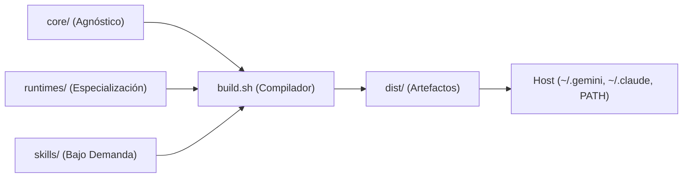

# Dotfiles-IA-Agents

[](#) [](#) [](#) [](#)

Repositorio modular de configuración, estándares y directivas de comportamiento para agentes de Inteligencia Artificial.

---

## Resumen Ejecutivo

Dotfiles-IA-Agents es una plataforma centralizada que estandariza las directivas operativas, servidores MCP y habilidades especializadas para agentes de Inteligencia Artificial (Antigravity y Claude Code). Mediante una arquitectura desacoplada en cuatro capas (*Core*, *Runtimes*, *Skills* y *Dist*), garantiza inmunidad normativa, gobierno determinista de ramas y control de calidad estático sin sobrecargar el contexto basal de los modelos.

---

## Arquitectura Esencial



---

## Puesta en Marcha Rápida (Quickstart)

```bash
# 1. Configurar variable de entorno para herramientas CLI
export PATH="${HOME}/.local/bin:${PATH}"
# 2. Clonar el repositorio
git clone https://github.com/JerbilX/Dotfiles-IA-Agents.git && cd Dotfiles-IA-Agents
# 3. Aprovisionamiento automático E2E (compilación, respaldos y symlinks)
./build.sh
# 4. Verificación de salud e integridad estática
./build.sh check
```

---

## Interfaces y Comandos Principales (`build.sh`)

| Comando | Descripción | Referencia Técnica |
| :--- | :--- | :--- |
| `build` | Compila directivas (`AGENTS.md`) y configuración MCP (`mcp_config.json`). | [docs/cli.md](docs/cli.md#1-build) |
| `link` | Crea enlaces simbólicos atómicos con respaldo seguro (`.bak`). | [docs/cli.md](docs/cli.md#2-link) |
| `skills` | Aprovisiona skills y expone binarios ejecutables en `~/.local/bin/`. | [docs/cli.md](docs/cli.md#3-skills) |
| `mcp` | Compila y enlaza exclusivamente servidores MCP. | [docs/cli.md](docs/cli.md#4-mcp) |
| `status` | Reporta el estado de symlinks y respaldos en cada runtime. | [docs/cli.md](docs/cli.md#5-status) |
| `rollback` | Reversión atómica al último respaldo previo ante emergencias. | [docs/cli.md](docs/cli.md#6-rollback) |
| `check` | Auditoría estática de integridad, esquemas y presupuestos. | [docs/cli.md](docs/cli.md#7-check) |
| `reconcile` | Ratifica formalmente ADRs post-merge (`proposed` $\rightarrow$ `accepted`). | [docs/cli.md](docs/cli.md#8-reconcile) |
| `workspace` | Aprovisiona skills y configuraciones de suite de dominio en un proyecto. | [docs/cli.md](docs/cli.md#9-workspace) |
| `all` | Pipeline completo por defecto (`build` $\rightarrow$ `link` $\rightarrow$ `skills` $\rightarrow$ `status` $\rightarrow$ `check`). | [docs/cli.md](docs/cli.md#10-all) |

---

## Mapa de Documentación y Convenciones

- **Instalación y Bootstrap:** Consulta [docs/setup.md](docs/setup.md) para precondiciones, `$PATH`, symlinks y troubleshooting.
- **Manual Exhaustivo CLI:** Consulta [docs/cli.md](docs/cli.md) para variables de entorno, códigos de salida y auditoría de contexto.
- **Diseño y Extensibilidad:** Consulta [docs/architecture.md](docs/architecture.md) para el modelo modular, schemas y cómo añadir runtimes.
- **Decisiones Arquitectónicas:** Gestionadas en [docs/adr/](docs/adr/) bajo estándar MADR vía `adr-manager`.
- **Flujo de Trabajo:** Prohibido push directo a `main`; cambios aislados en ramas efímeras y canalizados vía Pull Requests.
