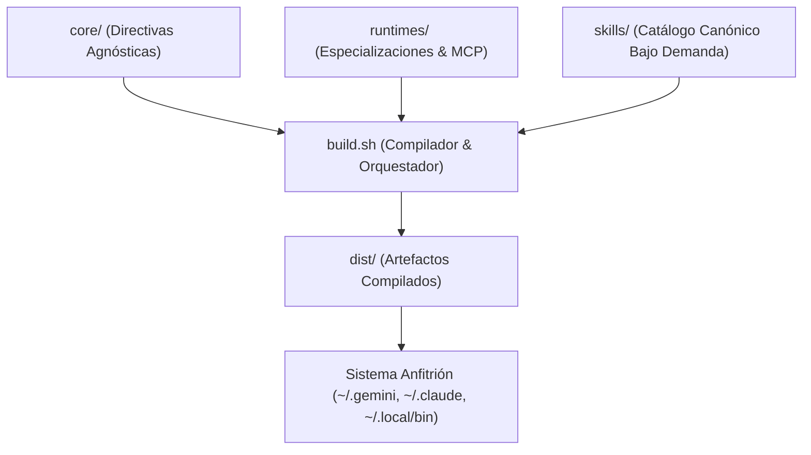

# Arquitectura y Diseño del Sistema (Architecture)

Documento explicativo del modelo arquitectónico, la organización modular, los contratos de validación declarativa y los mecanismos de extensibilidad de `Dotfiles-IA-Agents`.

---

## 1. Filosofía de Desacoplamiento Modular

`Dotfiles-IA-Agents` organiza las reglas y capacidades de agentes de IA bajo una arquitectura desacoplada en cuatro capas funcionales:



1. **Capa Basal Agnóstica (`core/`):** Directivas universales de ingeniería, objetividad, git y estabilidad lógica aplicables a cualquier runtime de IA.
2. **Capa de Especialización de Runtime (`runtimes/`):** Adaptadores, reglas específicas de entorno (como sandbox en Antigravity) y configuraciones de servidores MCP por agente.
3. **Capa de Habilidades Especializadas (`skills/`):** Procedimientos extensos y herramientas operativas cargadas bajo demanda, reduciendo la carga permanente del System Prompt.
4. **Capa de Distribución (`dist/`):** Artefactos finales generados deterministamente listos para ser enlazados con las rutas canónicas del sistema anfitrión.

---

## 2. Mapa Modular del Repositorio

```
Dotfiles-IA-Agents/
├── core/                                # Directivas agnósticas al runtime
│   ├── 01-objectivity.md                # Feedback crítico, cero complacencia y calidad técnica
│   ├── 02-git-lifecycle.md              # Ciclo de vida de Git, commit atómico y gates remotos
│   ├── 03-agent-rules-convention.md     # Convención canónica de AGENTS.md y estándar MADR
│   ├── 04-web-search-discipline.md      # Circuit breaker y disciplina de búsquedas web
│   ├── 05-anti-rigidity.md              # Degradación elegante y protocolo de fallback
│   ├── 06-engineering-standards.md      # Prevalencia de producción, lectura quirúrgica y blast radius
│   ├── 07-anti-hallucination.md         # Estabilidad lógica, Stop & Ask y blindaje de planes
│   ├── 08-task-backlog-management.md    # Backlog en GitHub Projects/Issues y control de scope creep
│   ├── 09-issue-driven-workflow.md      # Flujo guiado por issues, ramas y Pull Requests obligatorios
│   └── 10-environment-standards.md      # Confinamiento de workspace y uso de herramientas nativas
├── docs/                                # Documentación de ingeniería y arquitectura (Diátaxis)
│   ├── setup.md                         # Guía de aprovisionamiento, PATH y bootstrap
│   ├── cli.md                           # Referencia técnica exhaustiva del orquestador build.sh
│   ├── architecture.md                  # Este documento explicativo
│   └── adr/                             # Architectural Decision Records (estándar MADR)
├── modules/                             # Suites declarativas y plantillas de workspace por dominio
│   └── eso/                             # Módulo de desarrollo para Elder Scrolls Online
│       ├── module.json                  # Manifiesto formal del módulo
│       └── template/                    # Plantillas declarativas para repositorios de addons
│           ├── .agents/plugins/         # Configuración de plugin para Antigravity
│           └── .mcp.json                # Configuración nativa para Claude Code
├── runtimes/                            # Configuraciones y adaptadores por entorno
│   ├── schema/                          # Esquemas JSON canónicos de validación
│   │   ├── runtime-config.schema.json   # JSON Schema para manifiestos de runtime
│   │   ├── mcp-server.schema.json       # JSON Schema para módulos de servidores MCP
│   │   └── module-config.schema.json    # JSON Schema para módulos de dominio
│   ├── antigravity/                     # Adaptador para Google Antigravity
│   │   ├── rules/                       # Especializaciones normativas del runtime
│   │   ├── mcp/                         # Catálogo modular de servidores MCP
│   │   └── config.json                  # Manifiesto estructurado del runtime
│   └── claude/                          # Adaptador para Claude Code
│       ├── rules/                       # Reglas locales específicas de Claude
│       ├── mcp/                         # Catálogo modular de servidores MCP
│       └── config.json                  # Manifiesto estructurado del runtime
├── skills/                              # Catálogo canónico y autocontenido de skills
│   ├── adr-manager/                     # [Basal] Gestión de Architecture Decision Records (MADR)
│   ├── autonomous-learning/             # [Basal] Aprendizaje autónomo y consulta de precedentes
│   ├── conversation-audit/              # [Basal] Auditoría sistemática de transcripciones de agentes
│   ├── eso-addon-development/           # [Dominio] Estándares y utilidades para addons de ESO (workspace-bound)
│   ├── issue-driven-workflow/           # [Basal] Orquestación de desarrollo guiado por issues, PRs y CLI agent-module
│   └── project-documentation/           # [Basal] Estandarización Diátaxis y modularización documental
├── dist/                                # Artefactos compilados para distribución
│   ├── antigravity/
│   │   ├── AGENTS.md                    # Versión consolidada de directivas
│   │   └── mcp_config.json              # Configuración MCP con macros resueltas
│   └── claude/
│       ├── AGENTS.md                    # Versión consolidada de directivas para Claude
│       └── mcp_config.json              # Configuración MCP compilada para Claude
├── .gitignore                           # Exclusión de temporales (*.bak, *.tmp, .commit_msg)
├── build.sh                             # Script de compilación y orquestación multi-runtime
└── README.md                            # Documentación y referencia de entrada minimalista
```

---

## 3. Esquemas Declarativos y Validación

La integridad de las configuraciones se valida automáticamente contra esquemas JSON estándar (`Draft-07`):

### Manifiesto de Runtime (`runtime-config.schema.json`)
Gobierna la estructura de cada `runtimes/<runtime>/config.json`:
- `status`: Estado operativo del runtime (`"active"`: procesado y auditado por defecto, `"on-demand"`: procesado exclusivamente bajo demanda o con `all`, `"disabled"`: desactivado). Permite desacoplar entornos secundarios (como Claude Code) para optimizar latencia, telemetría e I/O en el flujo de trabajo diario sin eliminarlos del ecosistema.
- `skills`: Lista de nombres de carpetas en `skills/` que deben aprovisionarse para el runtime.
- `binaries`: Diccionario de alias para exponer binarios o scripts en `~/.local/bin/`.
- `mcp_servers`: Lista de nombres de servidores MCP definidos en `runtimes/<runtime>/mcp/`.
- `target`: Diccionario con rutas canónicas de destino (`config_dir`, `prompt_filename`, `skills_dir`).

### Módulo de Servidor MCP (`mcp-server.schema.json`)
Gobierna las definiciones modulares en `runtimes/<runtime>/mcp/<nombre>.json`:
- `command`: Binario o comando ejecutable.
- `args`: Lista de argumentos de invocación.
- `env`: Variables de entorno asociadas.

### Módulo de Dominio (`module-config.schema.json`)
Gobierna los manifiestos de dominio en `modules/<nombre>/module.json`:
- `name`: Identificador slug de la suite.
- `description`: Resumen funcional del módulo.
- `skills`: Skills requeridos por la suite.
- `binaries`: Alias de scripts/binarios para ejecución.
- `mcp_servers`: Servidores MCP aislados para el dominio.

### Aislamiento de Dominio por Workspace y Activación On-Demand (ADR-0041)
Para evitar la sobrecarga basal de tokens en el prompt inicial de proyectos genéricos, tanto los servidores MCP especializados como las skills de dominio (como `eso-addon-development`) se desacoplan del catálogo global y se confinan exclusivamente a los repositorios pertinentes mediante plantillas declarativas (`modules/<dominio>/template/`).
La activación en el workspace activo se realiza on-demand sin fricción mediante el CLI `agent-module` (`agent-module enable <modulo>`), ya sea por orden explícita del usuario en el chat o por confirmación ante detección proactiva de marcadores de dominio por parte del agente. El comando `agent-module disable <modulo>` permite la poda y reversibilidad inmediata.

---

## 4. Guía de Extensibilidad: Cómo Agregar un Nuevo Runtime

Agregar un nuevo entorno de agente es 100% declarativo y no requiere modificar una sola línea de `build.sh`:

1. **Crear Directorio del Runtime:**
   ```bash
   mkdir -p runtimes/<nuevo-runtime>/rules runtimes/<nuevo-runtime>/mcp
   ```

2. **Crear Manifiesto de Configuración:**
   Crea `runtimes/<nuevo-runtime>/config.json` cumpliendo el esquema:
   ```json
   {
     "$schema": "../schema/runtime-config.schema.json",
     "skills": [
       "adr-manager",
       "issue-driven-workflow",
       "project-documentation"
     ],
     "binaries": {
       "agent-audit": "agent-audit",
       "git-prune-gone": "git-prune-gone"
     },
     "mcp_servers": [],
     "target": {
       "config_dir": "${HOME}/.mi-agente",
       "prompt_filename": "AGENTS.md",
       "mcp_filename": "mcp_config.json",
       "skills_dir": "${HOME}/.mi-agente/skills"
     }
   }
   ```

3. **Agregar Reglas Específicas (Opcional):**
   Si el runtime requiere directivas particulares de sandbox o entorno, agrega archivos `NN-*.md` en `runtimes/<nuevo-runtime>/rules/`.

4. **Validar y Compilar:**
   ```bash
   ./build.sh check <nuevo-runtime>
   ./build.sh build <nuevo-runtime>
   ```
